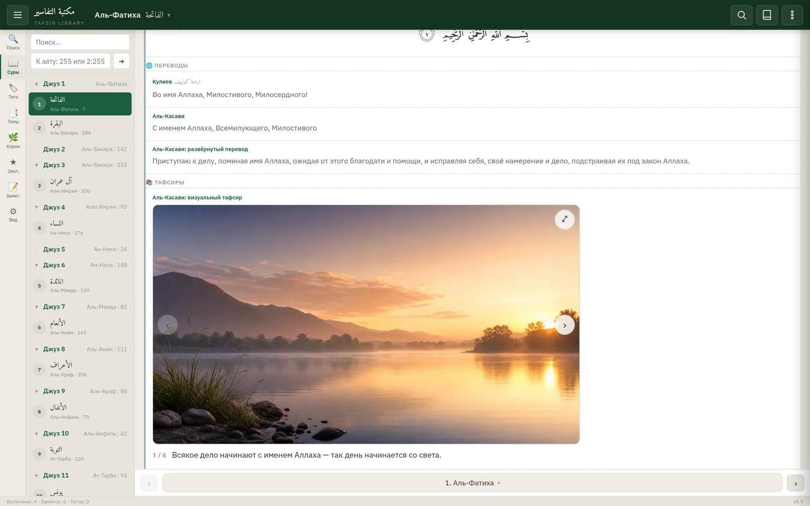
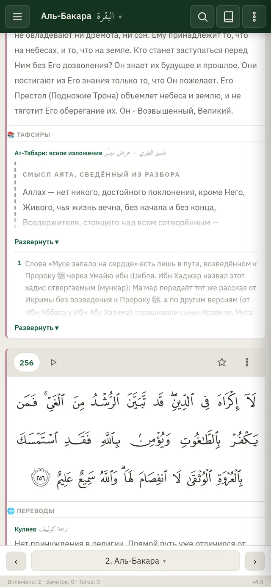
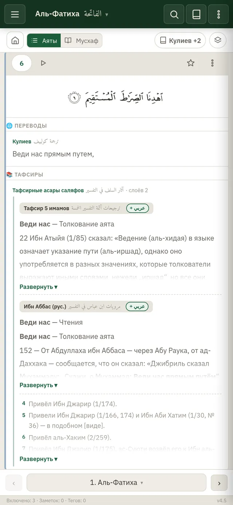
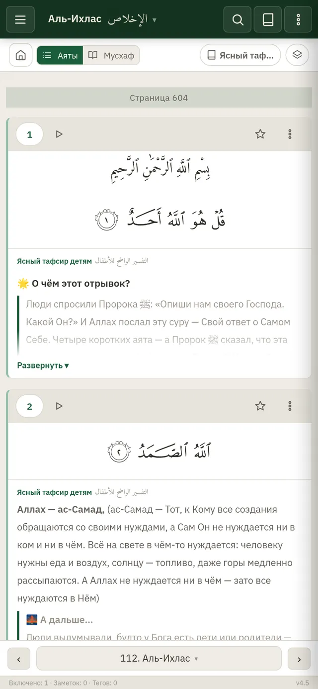
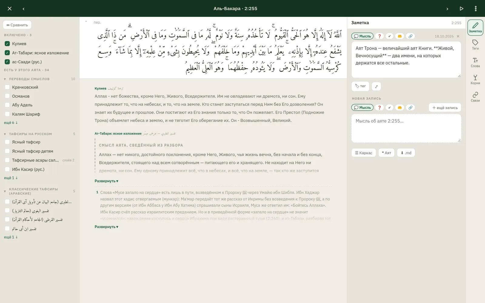
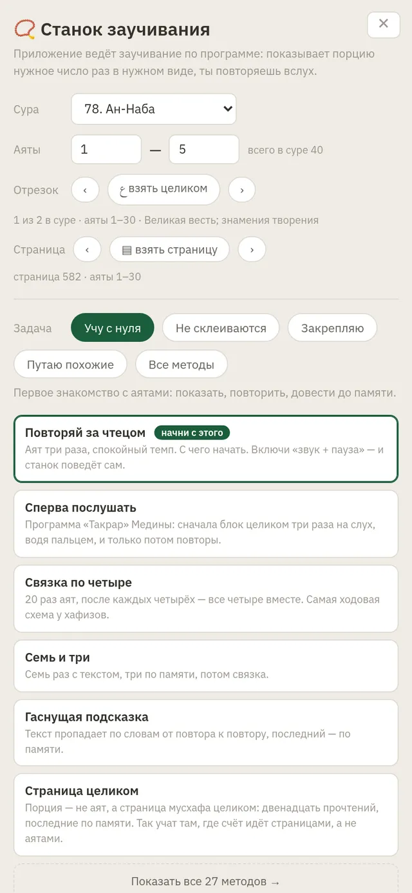
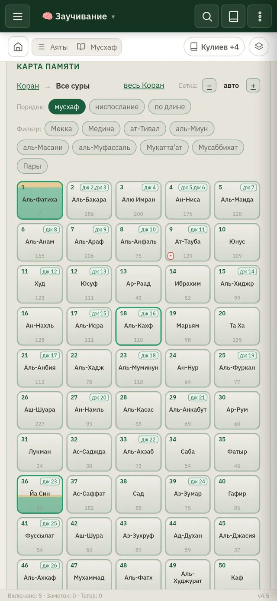
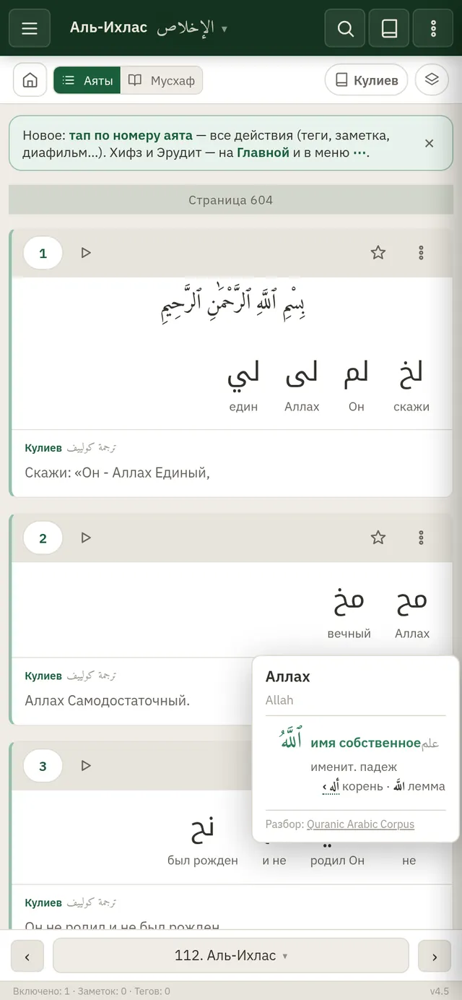
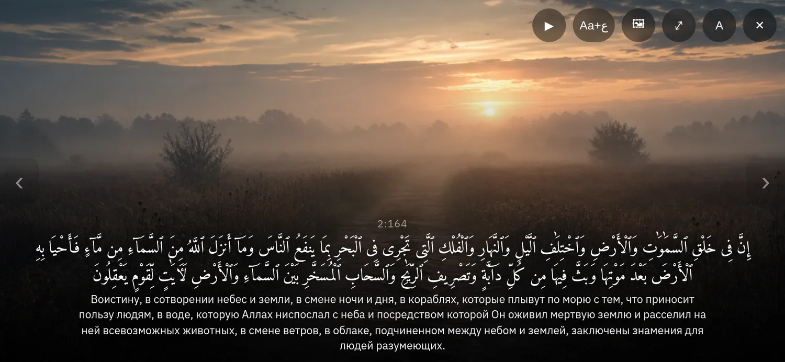

# Библиотека тафсиров · مكتبة التفاسير

**Коран, переводы и толкования учёных, собранные и связанные в одном месте.** 
Под каждым аятом столько толкований, сколько нужно: от детского пересказа до полного ат-Табари. 
С телефона и компьютера, без регистрации и без интернета.

**[Открыть приложение →](https://ismailovvism-oss.github.io/tafsir-app/)**

| 48 | 6236 | 604 | 1651 | 27 | 53 |
|:-:|:-:|:-:|:-:|:-:|:-:|
| источников и слоёв | аятов, у каждого свой набор толкований | страницы печатного мусхафа Медины | корень с картой всех вхождений | методов заучивания | чтецов |

---

## Источники с замыслом

Каждый источник сделан под свою задачу, и их можно включать вместе: под аятом они встают в том порядке, который вы задали.

### Ат-Табари: ясное изложение

Тафсир каждого аята из «Джами' аль-баян» прочитан целиком и изложен по-русски заново.

- **Врезка «Смысл аята».** Разбор открывается смыслом всего аята. Подпись честно говорит, чьи это слова: «по ат-Табари» или «сведённый из разбора».
- **Мнения с носителями** нумерованным списком, затем выбор имама с его доводом.
- **⚖ «Выбор не назван»** там, где имам привёл мнения, но не выбрал. За него ничего не додумано.
- Иснады, повторы и поэтические свидетельства сняты. Полемика о кадаре, сыфатах и касбе передана подробнее.
- Готовы аль-Фатиха и вся аль-Бакара: 293 аята, около 186 тысяч слов. Каждое утро аят с изложением выходит в канале.

### Тафсир аль-Касави: пять слоёв на каждый аят

Авторский тафсир приходит не одной книгой, а слоями: полный тафсир, **перевод**, **развёрнутый перевод** (перевод и краткое толкование одним абзацем), **визуальный тафсир** и свои темы-теги. Готовые слои — на аль-Фатиху.

**Визуальный тафсир:** под аятом листается кадр 16:9. Первый кадр — картина-метафора из природы (без людей, сокровенное не изображается), дальше 3–5 схем по главным тезисам и итоговая формула. Схемы перекрашиваются вместе с темой оформления. На одну аль-Фатиху — 43 кадра.

### Тафсирные асары саляфов

24-томный свод «аль-Мавсуа фи-т-тафсир аль-ма'сур» (92 093 асара) — **одним корпусом**: одна галочка в каталоге, одна карточка под аятом, внутри слои.

- **Костяк — «Тафсир 5 имамов»:** Ибн Джарир, Ибн Атыйя, Ибн Таймийя, Ибн аль-Кайим, Ибн Касир. Что каждый предпочёл, уточнил, отверг — с томом и страницей. На русский переведён полностью (3641 аят).
- **Передатчики — слоями** по первичной атрибуции. Отдельный слой получает тот, чьи асары есть хотя бы у 15% аятов: Мукатиль, Катада, Ибн Аббас, Муджахид, аль-Хасан аль-Басри и ещё семеро. Остальные сведены в «прочие», ничего не потеряно.
- **Ибн Аббас по-русски** — все его асары, 3676 аятов.

### Ясный тафсир — подросткам и детям

Переложение классических тафсиров (Ибн Касир, ат-Табари, аль-Куртуби, аль-Багави; поводы ниспослания — аль-Вахиди, ас-Суюти) на **весь Коран**, в двух версиях. Жирным набраны только слова аята: уберите пояснения в скобках, и останется цельный перевод. Сыфаты — без та'виля и без уподобления, хадисы — только достоверные, арабский текст подставляется из эталонного мусхафа.

### Классики в своих переводах

аль-Багави (суры 58–114 выверены и одобрены ✓✓), аль-Куртуби (перевод Исмаила Хаертдинова), Ибн Касир (Мухтасар, перевод А. Вахитова), ас-Саади, аль-Мунтахаб, «Мекканская школа тафсира». Арабские оригиналы целиком: ат-Табари, аль-Багави, аль-Куртуби, Ибн Аби Хатим.

&nbsp;
&nbsp;

---

## Работа над аятом

Тап по номеру аята → «Работа над аятом». Рабочее место для тадаббура: все включённые тафсиры подряд, а сбоку инструменты **Заметка · Теги · Слова · Корни · Связи · Источники**.

- **Сравнение** источников колонками: ширина подбирается по объёму текста, каждая колонка прокручивается сама.
- **Записи размышления** пяти видов: мысль, вопрос, вывод, дуа, связь. «Каркас» из четырёх вопросов тадаббура, дневник записей, выгрузка в .md для Obsidian.
- **Маркер слов** четырьмя цветами со своими именами.
- На телефоне инструменты уходят в нижний лист, экран отдан чтению.

## Карта заблуждений

Источник не прячется, а показывается **с ответами**. У спорного места рамка цвета важности (🔴 искажение хукма или акыды, 🟡 смысловой сдвиг, 🔵 тональность) и разбор: в чём ошибка и как правильно. Сам текст источника не меняется. У каждого источника своя карта отмеченных мест.

## Язык Корана

- **Пословный разбор прямо в ленте:** под словом подстрочник, касание — грамматика и корень из Quranic Arabic Corpus.
- **Конкорданс:** все 1651 корень со всеми местами в Коране; искать можно по-русски («милость» → رحم, 339 мест).
- **Тематический указатель** из 695 тем, свои иерархические теги.
- Текст с огласовками, без огласовок и без точек (расм); шесть начертаний, печатный мусхаф Медины с цветами таджвида.
- **Смысловые отрезки:** черта со знаком ع и названием темы между рукуʿ, у каждой темы свой цвет.

## Заучивание наизусть

**Станок хифза** ведёт заучивание по программе. 27 методов, выбор по задаче: «учу с нуля», «не склеиваются», «закрепляю», «путаю похожие». Порция — страница мусхафа или смысловой отрезок. Режим «звук + пауза», «цифровой лоух» (набор первых букв слов), «Близнецы» для муташабихат. Карта памяти и проверка с расписанием повторений.

&nbsp;
&nbsp;

## И ещё

- **Диафильм:** аят на весь экран с атмосферным фоном по теме; кадр меняется сам вслед за чтецом.
- **Эрудит:** названия сур, аяты, «узнать суру» по примете, слова Корана по частотности корней, таджвид, тартиб.
- **Аудио:** 53 чтеца, повтор аята до 1000 раз, пауза после аята, повтор диапазона, запись своего чтения.
- **Без интернета:** скачать суру, джуз или весь Коран. Синхронизация между устройствами по коду, без логина.
- Ссылка вида `?src=tabari_bayan_ru#2:255` открывает аят сразу с нужным тафсиром.

---

## Авторство и условия

Подготовка, переводы (аль-Багави, Ибн Аббаса), сведение воедино и код —
**Исмаил Абу Хаммад Алькасави**; перевод аль-Куртуби — его ученик
**Исмаил Хаертдинов**. Классические тафсиры и изданные переводы принадлежат их
авторам и включены лишь для пользы читающего.

Пользование — по завету: **[LICENSE](LICENSE)** (шариатский завет) и
**[NOTICE.md](NOTICE.md)** (нисба — кто над чем трудился). Труд отдан как садака
ради лика Аллаха; пользуйся свободно, но **сохрани нисбу** и не выдавай чужого
труда за свой.

Новости и отзывы — Telegram **[@tewhiid](https://t.me/tewhiid)**.

## Для разработчика

Статический сайт без сборки: один `index.html` (ванильный JS) и данные в `data/` (JSON).
Локально: `python3 -m http.server 8000` в корне и http://localhost:8000
(открывать `file://` нельзя — браузер не даст загрузить JSON).

- **[HELP.md](HELP.md)** — руководство пользователя; оно же открывается в приложении (⋯ → ❓ Справка).
- **[GUIDE.md](GUIDE.md)** — для мейнтейнера: формат данных, добавление тафсиров, разметка, словарь, шрифты, публикация.
- **[CHANGELOG.md](CHANGELOG.md)** — история изменений.
